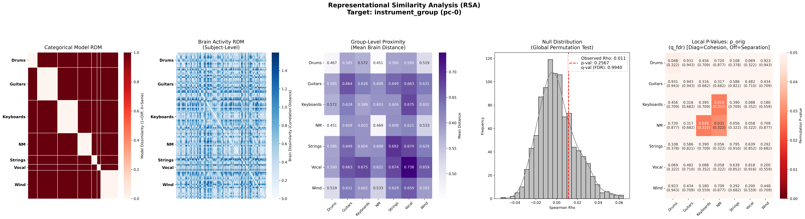
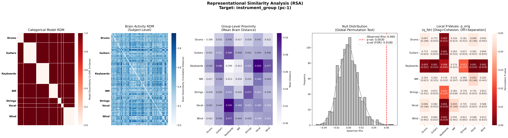
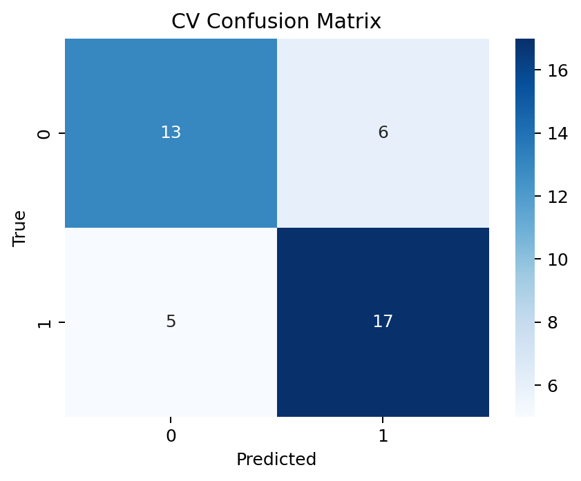
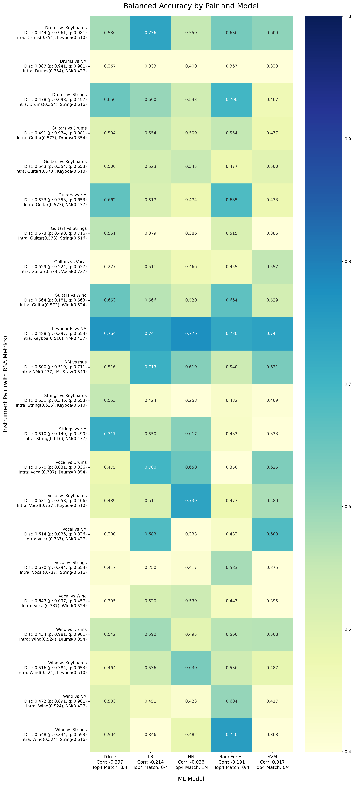

Run the group pipeline
================================================================================

This page covers the current two-movement workflow for feature Sets 0, 1,
and 4. It uses three scripts from the same source revision:

.. list-table::
   :header-rows: 1
   :widths: 28 72

   * - Script
     - Role
   * - ``run_all_background.sh``
     - Run the fPCA and classification stages in order using fixed paths
       defined inside the script.
   * - ``run_fpca.sh``
     - Run individual fPCA, group fitting, or test projection for both movements.
   * - ``run_pipeline.sh``
     - Run one downstream mode for selected feature sets and component indices.

Prepare the inputs
--------------------------------------------------------------------------------

Use :doc:`installation` to prepare ``fpca-env``. Then check the following:

* Put training recordings and masks in ``raw_data_train`` and test recordings
  and masks in ``raw_data_test``. The participant sets must be disjoint.
* Each participant must have both movements and a matching mask for each.
  Use the naming pattern described in :doc:`running`.
* Images and masks must have compatible shapes and spatial coordinates.
  The regional analysis uses the Schaefer 100-region, 7-network atlas.
  Resampling that atlas does not register an image into standard space.
* Use the correct TR. The current scripts use the Python default of 0.75 s.
  For Set 4, the workbook's scan times must match the recordings.
* For the Nilearn branch, include the matching fMRIPrep confound TSV and JSON
  files in the layout expected by Nilearn.

The metadata CSV must have one row per participant. ``sub_id`` identifies
the participant, ``instrument_group`` gives the classification group, and
``is_train_set`` must be numeric 1 for training or 0 for test. Its split must
agree with the input folders.

The alignment plots also use these columns from the current metadata format:
``group``, ``main_instrument``, ``genres``, ``has_classical``, ``has_jazz``,
``has_rock``, ``has_pop``, ``is_wind``, ``is_rhythm``, and ``pca_tSNE``.
Keep the supplied metadata structure when preparing a new file. Use unique
participant IDs and check that every loaded participant has a metadata row.

``ml_hyperparameters.json`` defines the model search values.
``test_pairs.json`` defines which trained group pairs to evaluate on the
test set. A minimal example of its structure is:

.. code-block:: json

   {"test_pairs": [["Guitars", "Drums"], ["NM", "mus"]]}

Pair names and their order must match the trained model folders. Keep the
full supplied pair list for the current analysis. Choose pairs before
looking at their test scores.

Set 4 also needs ``visualize_05102026.xlsx``. The current workbook has sheets
named ``Movement 1`` and ``Movement 2``, a scan-TR row, and instrument and
genre annotation rows. Keep its layout and scan timing. See
:doc:`implementation` for how those rows become regression inputs.

Prepare a working folder
--------------------------------------------------------------------------------

The full-run script calls ``./run_fpca.sh`` and ``./run_pipeline.sh``.
Its configuration files are also relative to the current working folder.
Copy these files into one run folder. Replace the example paths first:

.. code-block:: bash

   FMRI_CODE=/path/to/fMRI
   RUN_DIR=/path/to/fmri-run
   CONFIG_DIR=/path/to/analysis-inputs

   mkdir -p "$RUN_DIR"
   cp "$FMRI_CODE/src/full_pipeline/run_all_background.sh" "$RUN_DIR/"
   cp "$FMRI_CODE/src/fPCA/cli/run_fpca.sh" "$RUN_DIR/"
   cp "$FMRI_CODE/src/PCAGroupDiscrimination/cli/run_pipeline.sh" "$RUN_DIR/"
   cp "$FMRI_CODE/src/PCAGroupDiscrimination/cli/ml_hyperparameters.json" "$RUN_DIR/"
   cp "$CONFIG_DIR/status_fMRI_participants_05102026.csv" "$RUN_DIR/"
   cp "$CONFIG_DIR/test_pairs.json" "$RUN_DIR/"
   cp "$CONFIG_DIR/visualize_05102026.xlsx" "$RUN_DIR/"
   cd "$RUN_DIR"
   chmod +x run_all_background.sh run_fpca.sh run_pipeline.sh

Before running, edit the paths near the top of ``run_all_background.sh``:

* ``OUTPUT_DIR_RAW`` is the parent of ``raw_data_train`` and ``raw_data_test``.
* The two ``OUTPUT_DIR`` assignments choose the filtered and basic output
  folders. They are separate fixed paths. Changing ``OUTPUT_DIR_RAW`` alone
  does not change them.
* ``METADATA``, ``HYPERPARAMS``, ``TEST_PAIRS``, and ``ANNOTATION_XLSX`` must
  match the files in the run folder, or use absolute paths.

The examples below retain the script's current root,
``/mnt/my_passport/R_output``. Adjust it everywhere if your data are elsewhere.

Understand the four configurations
--------------------------------------------------------------------------------

The recent runs requested ``--sets "1 0 4"`` in four combinations:

.. list-table::
   :header-rows: 1
   :widths: 22 28 50

   * - Signal
     - Extra full-run flags
     - Preprocessing and output branch
   * - fPCA
     - None
     - Basic preprocessing; ``output_no_filter``.
   * - fPCA
     - ``--filter``
     - Nilearn preprocessing; ``output_filter1``.
   * - BOLD without fPCA
     - ``--raw --skip-fpca``
     - Basic preprocessing; raw result folders in ``output_no_filter``.
   * - BOLD without fPCA
     - ``--raw --skip-fpca --filter``
     - Nilearn preprocessing; raw result folders in ``output_filter1``.

``output_no_filter`` is a historical folder name. The program still applies
spatial box smoothing and temporal band-pass filtering in this branch.
``--filter`` selects a different preprocessing procedure; it does not
simply add a filter to an otherwise untouched signal.

.. important::

   The current raw-data cache does not record the feature set or its spatial
   centering setting. Running raw Sets 0, 1, and 4 together can make Set 4
   reuse the uncentered cache from Sets 0 and 1. It can also reuse stale
   data after input or preprocessing changes. For new raw runs, use the
   separate Set 4 cache folder shown below.

Run the fPCA configurations
--------------------------------------------------------------------------------

Create the log directories before using shell redirection:

.. code-block:: bash

   mkdir -p /mnt/my_passport/R_output/output_no_filter
   mkdir -p /mnt/my_passport/R_output/output_filter1

Run the basic preprocessing configuration:

.. code-block:: bash

   nohup ./run_all_background.sh --sets "1 0 4" \
     > /mnt/my_passport/R_output/output_no_filter/all_run.log 2>&1 &

Run the Nilearn configuration when the machine has enough free resources:

.. code-block:: bash

   nohup ./run_all_background.sh --sets "1 0 4" --filter \
     > /mnt/my_passport/R_output/output_filter1/all_run.log 2>&1 &

``nohup`` lets a command continue after the terminal closes; ``&`` puts it
in the background. Neither one schedules jobs or prevents two runs from
writing to the same folder. For a simple, reproducible workflow, let each
run finish before starting another in the same output branch.

Do not run fPCA and raw Set 4 at the same time in one branch. Their result
folders differ, but the full-run script uses the same Set 4 log filenames.
Use a fresh analysis root when rerunning a changed configuration.

What the full-run script does
--------------------------------------------------------------------------------

Unless ``--skip-fpca`` is set, it runs:

1. Individual fPCA for training recordings.
2. Individual fPCA for test recordings, in the same output tree.
3. Group fPCA using only the training recordings.
4. Projection of test recordings onto the training group basis.

For each requested feature set, the downstream modes then run in this order:

.. list-table::
   :header-rows: 1
   :widths: 20 80

   * - Mode
     - Work performed
   * - ``align-signals``
     - Make feature plots and run representational similarity analysis (RSA)
       using training participants. This does not shift or register recordings.
   * - ``ml``
     - Tune and evaluate classifiers on training participants, then fit and
       save the final models using the training data.
   * - ``stat``
     - Read training results and write summary tables and ROI importance files.
   * - ``ml-test``
     - Load saved models and predict test participants for the requested pairs.
   * - ``stat-test``
     - Combine training and test results into summary tables.

For fPCA Sets 0 and 1, the full-run script trains classifiers for component
indices 0 and 1. Its alignment step defaults to indices 0 through 6.
For Set 4, it runs alignment and classification only once.

The full-run script accepts ``--sets``, ``--filter``, ``--raw``,
``--encoding-source``, ``--skip-fpca``, and ``--annotation-xlsx``.
It does not forward arbitrary options to the lower-level commands.
Always supply ``--sets "1 0 4"`` for this workflow; the script's default
also includes Set 3, which is outside this guide.

``--skip-fpca`` is appropriate for a downstream rerun only when its required
fPCA outputs already match the intended data and settings. For a raw run,
fPCA outputs are not needed, but ``--raw`` alone does not skip their creation;
also supply ``--skip-fpca``.

The full-run script currently uses 20 fPCA workers and 32 classifier-search
workers through its wrappers. It has no ``--jobs`` option of its own.
Use the lower-level examples below when you need smaller worker counts.

Run stages separately
--------------------------------------------------------------------------------

For a fresh fPCA output, run the four fPCA commands in order:

.. code-block:: bash

   DATA_ROOT=/mnt/my_passport/R_output
   BRANCH="$DATA_ROOT/output_no_filter"

   ./run_fpca.sh pca-singles "$DATA_ROOT/raw_data_train" "$BRANCH/output_pca" --n-jobs 4
   ./run_fpca.sh pca-singles "$DATA_ROOT/raw_data_test" "$BRANCH/output_pca" --n-jobs 4
   ./run_fpca.sh train-pca-group "$DATA_ROOT/raw_data_train" "$BRANCH/output_pca" --n-jobs 4
   ./run_fpca.sh test-pca-project "$DATA_ROOT/raw_data_test" "$BRANCH/output_pca" --n-jobs 4

For the Nilearn branch, use ``output_filter1`` and append the three filter
options from :doc:`running` to all four commands.

Run the five downstream modes for Sets 0 and 1:

.. code-block:: bash

   for mode in align-signals ml stat ml-test stat-test; do
     ./run_pipeline.sh \
       --mode "$mode" \
       --features-sets "0 1" \
       --pc-index "0 1" \
       --max-pc 1 \
       --input-dir "$BRANCH/output_pca" \
       --output-dir "$BRANCH/output_pipeline" \
       --metadata-file status_fMRI_participants_05102026.csv \
       --hyperparameters-file ml_hyperparameters.json \
       --test-pairs-file test_pairs.json \
       --jobs 4 || break
   done

Here, ``--max-pc 1`` limits alignment to components 0 and 1.
``--pc-index`` controls the other modes. During alignment, the wrapper
instead runs every index from 0 to ``--max-pc``, inclusive, in parallel.
Check the first failing mode before continuing; do not skip over failures.

For Set 4 on individual fPCA reconstructions, use the same loop with
``--features-sets "4"``, ``--pc-index "0"``, and ``--max-pc 0``, and add
``--encoding-source fpca --annotation-xlsx visualize_05102026.xlsx``.
The component index is just a required wrapper setting for this run.
Set 4 still uses seven individual components by default.

Run the raw configurations with separate caches
--------------------------------------------------------------------------------

First run raw Sets 0 and 1. Use only one of these commands at a time:

.. code-block:: bash

   ./run_all_background.sh --sets "1 0" --raw --skip-fpca

   ./run_all_background.sh --sets "1 0" --raw --skip-fpca --filter

Then run raw Set 4 with a separate cache parent. In the raw branch,
``--input-dir`` supplies that parent; the recordings themselves come from
``--raw-data-path``. The following example is for basic preprocessing:

.. code-block:: bash

   DATA_ROOT=/mnt/my_passport/R_output
   BRANCH="$DATA_ROOT/output_no_filter"
   FILTER_ARGS=()
   mkdir -p "$BRANCH/raw_set4_cache"

   for mode in align-signals ml stat ml-test stat-test; do
     RAW_INPUT="$DATA_ROOT/raw_data_train"
     if [[ "$mode" == "ml-test" || "$mode" == "stat-test" ]]; then
       RAW_INPUT="$DATA_ROOT/raw_data_test"
     fi

     ./run_pipeline.sh \
       --mode "$mode" \
       --features-sets "4" \
       --pc-index "0" \
       --max-pc 0 \
       --input-dir "$BRANCH/raw_set4_cache" \
       --output-dir "$BRANCH/output_pipeline" \
       --raw-data-path "$RAW_INPUT" \
       --encoding-source raw \
       --annotation-xlsx visualize_05102026.xlsx \
       --metadata-file status_fMRI_participants_05102026.csv \
       --hyperparameters-file ml_hyperparameters.json \
       --test-pairs-file test_pairs.json \
       --jobs 4 \
       "${FILTER_ARGS[@]}" || break
   done

For the Nilearn version, change the branch and the filter array before
running the same loop:

.. code-block:: bash

   BRANCH="$DATA_ROOT/output_filter1"
   FILTER_ARGS=(--use-nilearn-filter --n-compcor-nilearn-filter 2 --smoothing-fwhm-nilearn-filter 4)
   mkdir -p "$BRANCH/raw_set4_cache"

Use a new cache folder when the recordings, masks, preprocessing settings,
or source code change. The current cache filenames do not detect such
changes. In a given cache parent, training raw data use
``processed_raw_data_cache.joblib`` and test raw data use
``processed_raw_data_cache_test.joblib``.

Group-fPCA features also use caches under ``--input-dir``, with names
starting with ``recoverd_pcs_``. New fPCA outputs should therefore use a
new parent folder. Set 4's individual-fPCA loader currently bypasses its
feature cache and reconstructs the signals again.

Wrapper options and direct Python options
--------------------------------------------------------------------------------

``run_pipeline.sh`` accepts the options shown above, plus
``--ml-models``, ``--groups``, ``--n-permutations``, ``--run-permutations``,
and ``--acoustic-features-dir``. Its default model list is
``SVM LR NN DTree RandForest``. Its default maximum alignment component
index is 6 and its default worker count is 32.

Some option names differ in the direct Python command:

.. list-table::
   :header-rows: 1
   :widths: 36 36 28

   * - ``run_pipeline.sh``
     - ``fmri-fpca-pipeline``
     - Meaning
   * - ``--features-sets "0 1"``
     - ``--extra-features-set 0``
     - The wrapper loops over sets; the direct command accepts one set.
   * - ``--pc-index "0 1"``
     - ``--target-pc-index 0``
     - The wrapper loops over indices outside alignment.
   * - ``--metadata-file``
     - ``--metadata-csv``
     - Participant table.
   * - ``--hyperparameters-file``
     - ``--ml-hyperparameters-file``
     - Model search configuration.
   * - ``--raw-data-path``
     - ``--use-raw-data --raw-data-path``
     - The wrapper adds the raw-data flag and the ``-raw`` result suffix.
   * - ``--max-pc``
     - No matching option
     - Controls the wrapper's alignment loop.

The direct command also has ``--n-pcs`` (default 7), ``--TR`` (default
0.75), ``--n-windows-per-exp`` (default 6), and ``--cache-file-pardir``
(default: input folder). The wrapper does not forward these options.
Its unknown options are currently ignored, so a misspelled or unsupported
flag can leave the default in place. Use only documented wrapper options
and check the logged settings.

For direct raw commands, create the output folder name with ``-raw``
yourself. The Python command does not add the feature-set folder for you.

Find the results
--------------------------------------------------------------------------------

All paths below are relative to ``<branch>/output_pipeline``:

.. list-table::
   :header-rows: 1
   :widths: 28 36 36

   * - Analysis
     - Training folder
     - Test folder
   * - fPCA Set 0 or 1, component ``k``
     - ``full_pipeline_setN/2_ml_pc-k``
     - ``full_pipeline_setN/3_ml_test_pc-k``
   * - Raw Set 0 or 1
     - ``full_pipeline_setN-raw/2_ml_raw``
     - ``full_pipeline_setN-raw/3_ml_test_raw``
   * - fPCA Set 4
     - ``full_pipeline_set4/2_ml_acoustic-fpca``
     - ``full_pipeline_set4/3_ml_test_acoustic-fpca``
   * - Raw Set 4
     - ``full_pipeline_set4-raw/2_ml_acoustic-raw``
     - ``full_pipeline_set4-raw/3_ml_test_acoustic-raw``

Replace ``N`` by 0 or 1 and ``k`` by the component index. Each summary
folder is named ``global_summary``. It contains ``all_pairs_summary.csv``
and ``pairs_overview.csv``. The training summary also contains the ROI
importance files used by the dashboard. Set 4 writes its annotation
regressors under ``0_regressors`` in the feature-set output folder.

Example output plots
--------------------------------------------------------------------------------

The figures below are examples from the earlier documentation. They show
the layout of the outputs, not the results of the current runs. Use the
files from your own run for scores and statistical conclusions. Select an
image to open it at full size, especially the wide RSA panels and long
summary plots.

Participant features
~~~~~~~~~~~~~~~~~~~~~~~~~~~~~~~~~~~~~~~~~~~~~~~~~~~~~~~~~~~~~~~~~~~~~~~~~~~~~~~~

The alignment heatmap places participants in rows and their feature values
in columns. Participants are grouped by their metadata labels. Use this
view to inspect broad patterns and unusual rows before reading classifier
results. A visible pattern alone does not establish a group difference.

.. figure:: _static/flattened_alignment_instrument_group_pc-1.png
   :align: center
   :width: 440px
   :alt: Feature heatmap with participants in rows, grouped by instrument.

   Example feature matrix for component 1, grouped by instrument category.

Distances between participants and groups
~~~~~~~~~~~~~~~~~~~~~~~~~~~~~~~~~~~~~~~~~~~~~~~~~~~~~~~~~~~~~~~~~~~~~~~~~~~~~~~~

Representational similarity analysis (RSA) compares the pattern of feature
distances with the pattern defined by the group labels. The example panels
show the label pattern, participant distances, average distances between
groups, and statistical summaries from that example run.

   Example RSA output for component 0.

   Example RSA output for component 1. Each component is a separate analysis.

Correct and incorrect predictions
~~~~~~~~~~~~~~~~~~~~~~~~~~~~~~~~~~~~~~~~~~~~~~~~~~~~~~~~~~~~~~~~~~~~~~~~~~~~~~~~

In a confusion matrix, rows are the true classes and columns are the
predicted classes. The diagonal counts correct predictions; the other
cells count errors. The figure below reports cross-validation predictions.
Keep these separate from predictions for the held-out test participants.

   Example logistic regression confusion matrix for component 1.

Compare pairs and model families
~~~~~~~~~~~~~~~~~~~~~~~~~~~~~~~~~~~~~~~~~~~~~~~~~~~~~~~~~~~~~~~~~~~~~~~~~~~~~~~~

The summary heatmap places group pairs in rows and model families in
columns. Each cell shows balanced accuracy. Use the current summary CSV
to read the exact values and identify the model selected by training
cross-validation.

   Example training summary. The colours show prediction scores, not
   statistical significance.

Read the statistics correctly
--------------------------------------------------------------------------------

``balanced_accuracy`` is a training cross-validation score.
``cv_best_model`` identifies the model family selected by its training
cross-validation score. ``test_of_best_cv_model`` is that family's held-out
test score. Selecting the largest test score across models would use the
test set to choose the model and answers a different question.

The recent commands do not set ``--run-permutations``. They produce five
placeholder training permutations, not a valid training significance test.
The corrected summary leaves the corresponding significance fields empty.
Increasing ``--n-permutations`` alone does not enable the full nested test.

For valid nested training permutations, the summary requires the nested
mode and at least 100 successful permutations. That more expensive mode
is outside the current implementation description. An empty training
p-value is not evidence of significance or of no effect.

On the test set, ``test_sel_p`` is the exact, one-sided label-permutation
p-value for the model selected by training cross-validation.
``test_sel_p_fwer`` applies a Bonferroni correction over the summary's
group pairs. This does not correct a later search across feature sets,
components, preprocessing branches, or repeated test analyses.

Legacy columns for analytic training tests, model-average tests, ensemble
tests, and ``test_sel_q`` may remain in the CSV schema but are empty in the
corrected summary. Do not substitute them for the supported test columns.
RSA describes the distances between training feature representations; it
does not establish classifier or ROI significance.

See :doc:`implementation` for the validation procedure and
:doc:`roi_explorer_guide` for regional interpretation.

