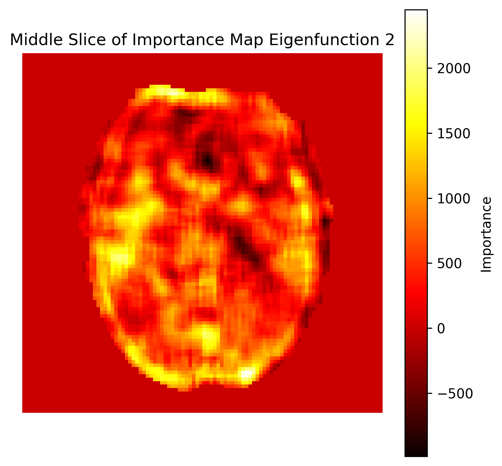
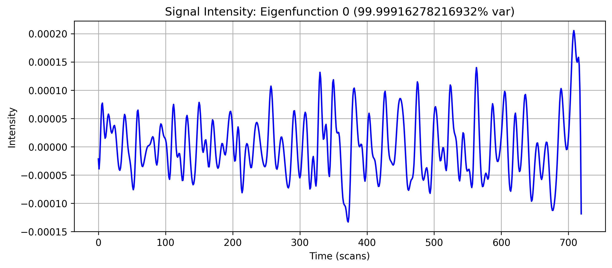
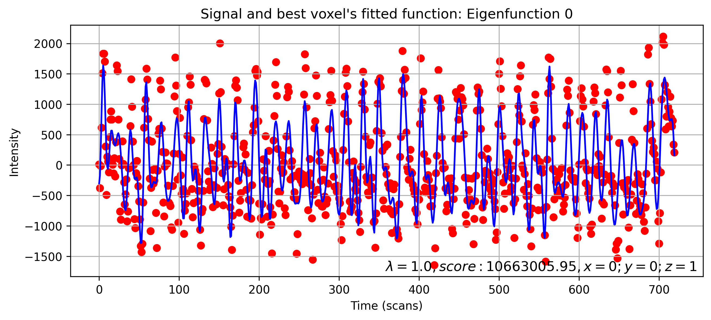

Overview
================================================================================

Functional principal component analysis (fPCA) describes the main patterns
of change in an fMRI recording. It first fits a smooth curve to each voxel.
It then finds temporal patterns that explain variation across these curves.
Each pattern has a score at each voxel. A score may be positive or negative.

The group analysis uses these signals to build features for each participant.
It trains classifiers to distinguish pairs of participant groups and tests
the saved classifiers on participants kept out of training.

The current workflow
--------------------------------------------------------------------------------

The workflow uses two musical movements. Each participant needs a recording
and a matching brain mask for each movement.

1. Prepare separate training and test input folders, and record the same split
   in the participant metadata.
2. Run fPCA separately for every participant and movement.
3. Fit a shared fPCA basis using the training participants only, separately
   for each movement.
4. Project the test participants onto the corresponding training basis.
5. Build participant features, fit classifiers, and write training summaries.
6. Apply the saved classifiers to the test participants and write test summaries.

There is also a comparison that uses preprocessed BOLD signals directly.
The scripts call this the ``raw`` branch. Here, ``raw`` means that fPCA is
not used to build the participant features. It does not mean unprocessed
scanner data.

Feature sets covered here
--------------------------------------------------------------------------------

.. list-table::
   :header-rows: 1
   :widths: 12 44 44

   * - Set
     - Features
     - Signal source
   * - 0
     - Regional signals joined into one feature vector.
     - One group principal component, or the preprocessed BOLD signal.
   * - 1
     - Regional standard deviation, mean absolute value, and six window
       means, separately for each movement.
     - The same sources as Set 0.
   * - 4
     - Regression coefficients that relate regional signals to the music
       annotation.
     - Each participant's own seven-component fPCA reconstruction, or
       the preprocessed BOLD signal.

For fPCA Sets 0 and 1, component indices 0 and 1 are separate analyses.
Set 4 combines the participant's retained components before regression.
It is not a separate analysis for each component index.

The program has other options and feature sets. This guide focuses on
Sets 0, 1, and 4 used in the current workflow.

What the outputs mean
--------------------------------------------------------------------------------

* fPCA temporal profiles describe variation over time. Their voxel maps
  contain signed component scores.
* Classification scores describe prediction of participant labels.
  Balanced accuracy gives equal weight to the two classes.
* Regional feature importance describes how a fitted classifier uses its
  inputs. It is different from an fPCA voxel score and from a statistical
  test of a brain region.

A strong prediction score does not, by itself, show why the groups differ.
Agreement between classifiers is useful to inspect, but does not establish
a biological mechanism.

Example fPCA outputs
--------------------------------------------------------------------------------

These figures come from earlier example runs. They show how to read the
outputs; their values and variance percentages are not results from the
current runs. Select an image to open it at full size.

The current ``run_fpca.sh`` uses ``--low-mem``, which skips these PNG plots.
See :doc:`running` for the saved data and plotting options.

Where a component appears in the brain
~~~~~~~~~~~~~~~~~~~~~~~~~~~~~~~~~~~~~~~~~~~~~~~~~~~~~~~~~~~~~~~~~~~~~~~~~~~~~~~~

A voxel map shows the signed score of one component at each voxel.
The older plot calls this value "Importance". It is an fPCA score, not
classifier feature importance or a test of regional significance.

   Example spatial score map for component 2. Component indices start at 0.

How a component changes over time
~~~~~~~~~~~~~~~~~~~~~~~~~~~~~~~~~~~~~~~~~~~~~~~~~~~~~~~~~~~~~~~~~~~~~~~~~~~~~~~~

The temporal profile shows the shape of one component over the recording.
Its voxel scores describe how strongly that shape contributes at each
location. The example below shows component 0, rather than component 2
shown in the spatial map above.

   Example temporal profile. This older image labels time in scans;
   the current plotting code uses seconds.

Check the fitted curve at one voxel
~~~~~~~~~~~~~~~~~~~~~~~~~~~~~~~~~~~~~~~~~~~~~~~~~~~~~~~~~~~~~~~~~~~~~~~~~~~~~~~~

The program also plots the voxel with the largest signed score for a
component. The red points are the voxel samples used for fitting. The blue
line is its fitted smooth curve, before reconstruction from selected
components. Here, "best voxel" refers to the score used to select the
voxel, not to the smallest fitting error.

   Example voxel selected using its score for component 0.

Where to go next
--------------------------------------------------------------------------------

* :doc:`math` explains the method with equations and simple definitions.
* :doc:`installation` gives one installation route based on a mamba environment.
* :doc:`group_pipeline` gives the full run order and explains the outputs.
* :doc:`running` documents the fPCA commands and their parameters.
* :doc:`roi_explorer_guide` explains the dashboard and its current limits.
* :doc:`implementation` explains the calculations used in the current runs.

