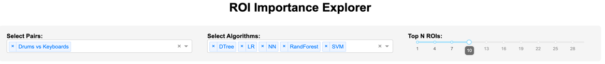
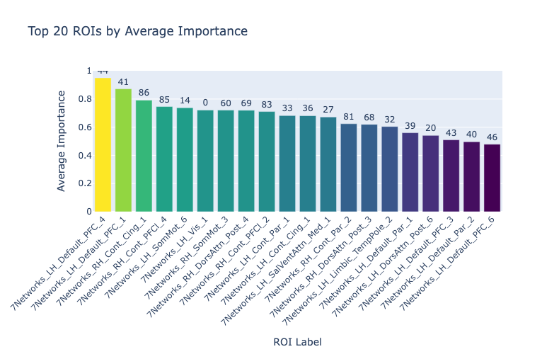
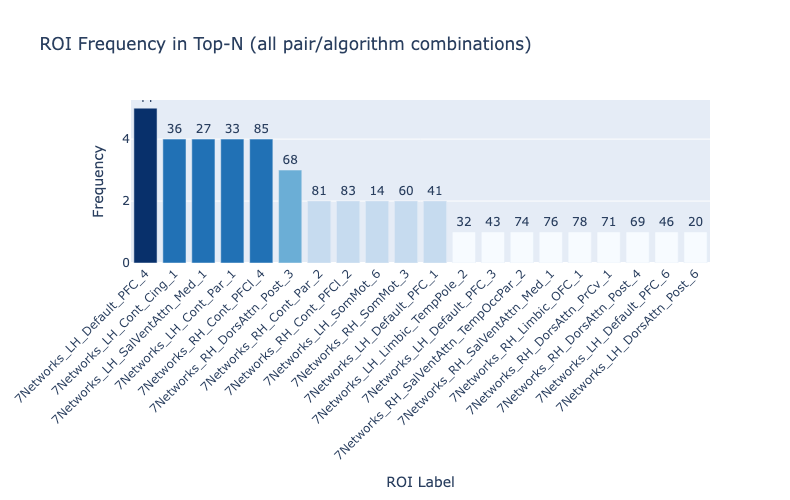
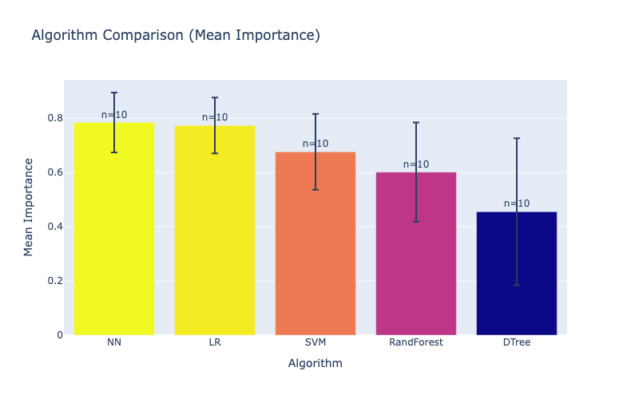
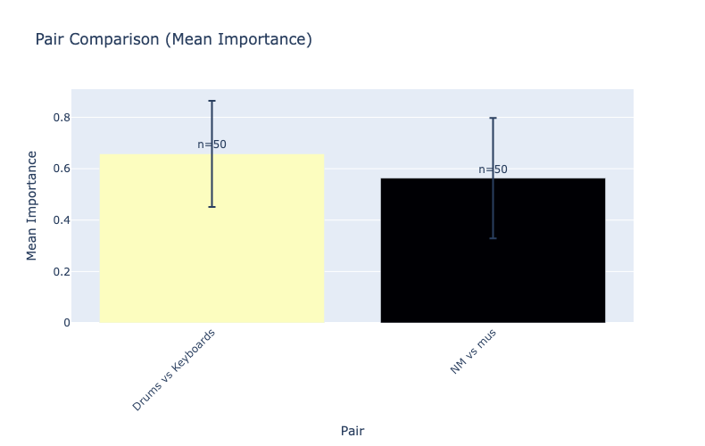
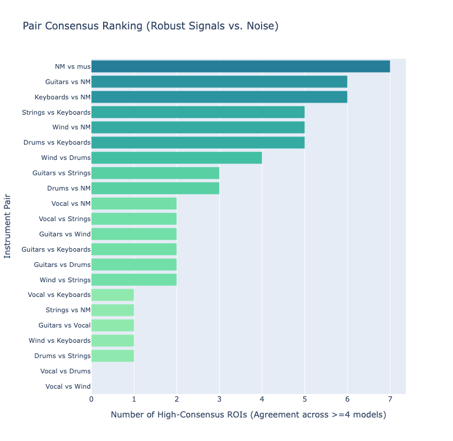
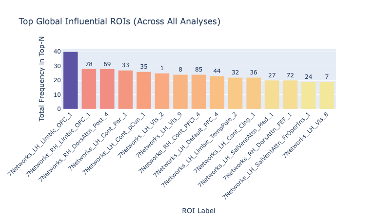

ROI Explorer dashboard
================================================================================

The dashboard displays regional feature importance from saved classifiers.
A region of interest (ROI) is a group of voxels defined by the atlas.
Use this view to inspect model inputs and compare their rankings.
It does not perform a new significance test or establish a biological cause.

The screenshots below come from earlier examples. They illustrate the
display, not current regional findings. Some newer controls are not shown.
Select an image to open it at full size.

Prepare the data
--------------------------------------------------------------------------------

Complete ``ml`` and then ``stat`` for the analysis you want to inspect.
Use the resulting ``roi_importance_all.csv`` in the training
``global_summary`` folder. For example:

.. code-block:: text

   output_pipeline/full_pipeline_set1/2_ml_pc-0/global_summary/roi_importance_all.csv

If present, keep these files beside it:

* ``roi_importance_mov1_all.csv``
* ``roi_importance_mov2_all.csv``

The dashboard detects them by these exact names. They show feature
importance assigned to each movement within the same fitted analysis.
They do not represent two models trained separately on the movements.

The required columns are:

.. list-table::
   :header-rows: 1
   :widths: 24 76

   * - Column
     - Meaning
   * - ``pair``
     - The compared participant groups.
   * - ``ml_model``
     - The classifier family, such as LR or SVM.
   * - ``roi_label``
     - The exported anatomical label. Check its mapping before interpretation.
   * - ``roi_index``
     - The regional feature position. Do not assume that it is an atlas value.
   * - ``importance``
     - The importance value exported from the fitted model.
   * - ``rank``
     - The saved rank within that pair and model. Lower ranks come first.

Check the regional labels first
--------------------------------------------------------------------------------

.. important::

   The current extraction code uses atlas value ``i + 1`` for feature
   position ``i``, but takes the displayed label from ``atlas.labels[i]``.
   Some Nilearn atlas versions include ``Background`` at position 0.
   With that label list, the exported labels are shifted by one position
   and there is an extra, empty feature slot at the end.

   Check the atlas values, feature positions, and label list together before
   naming anatomical findings. A ``Background`` row with nonzero importance
   is a warning sign. Dropping that row does not repair the shifted labels.
   The dashboard displays the CSV labels as supplied and does not correct
   this mapping.

With a 100-parcel atlas and a 101-item list starting with ``Background``,
feature positions 0 through 99 correspond to atlas values 1 through 100.
Position 100 has no matching parcel. For this specific case, the anatomical
names for positions 0 through 99 are in label-list positions 1 through 100.
Verify the actual list before applying that correction to an exported copy.

Launch the dashboard
--------------------------------------------------------------------------------

Use the same ``fpca-env`` environment as the analysis. The installation
already includes Dash and Plotly; no separate dashboard installation is
needed.

The following starts the current command-line interface with an explicit
CSV path:

.. code-block:: bash

   python -m PCAGroupDiscrimination.cli.explore_roi \
     /path/to/global_summary/roi_importance_all.csv \
     --port 8050

Open ``http://127.0.0.1:8050`` on the same computer. Press ``Ctrl+C`` in the
terminal to stop the server.

You can also pass the ``global_summary`` folder or its immediate ML parent.
The file finder checks the supplied directory, its ``global_summary``
subfolder, and parent directories. It does not search all child analyses
recursively. Use the exact CSV path when several analyses are available.

The current server binds to ``0.0.0.0``, which includes all network
interfaces. Although the CLI accepts ``--host``, the value is not passed to
the server. To bind only to the local computer with this code version, use:

.. code-block:: bash

   python - /path/to/global_summary/roi_importance_all.csv <<'PY'
   import sys
   from PCAGroupDiscrimination.roi_explorer_dashboard import ROIExplorerDashboard

   dashboard = ROIExplorerDashboard(sys.argv[1], port=8050, debug=False)
   dashboard.app.run(host="127.0.0.1", port=8050, debug=False)
   PY

The ``--debug`` CLI flag is for development. It is not needed for inspecting
results.

Use the controls
--------------------------------------------------------------------------------

Choose the group pairs and classifier families you want to inspect.
The Top N slider ranges from 1 to 30 and starts at 10. It keeps rows whose
saved ``rank`` is at most N. The dashboard does not recompute ranks after
you change a filter, and it does not remove zero-importance rows before
applying this cutoff.

   Pair, model, and Top N controls. The current dashboard also has the
   movement view selector described below.

The three view modes are:

* **Concatenated (mov1+mov2):** show the combined importance file.
* **Separate per movement:** show the movement files, when available.
* **All views:** show the movement views together with the combined view.

If no movement files were loaded, the display falls back to the combined
data. The detailed table contains all ranks for the selected pairs and
models; the Top N slider does not restrict it. Click a column heading to
sort, or use the filter boxes under the headings.

Understand the plots
--------------------------------------------------------------------------------

In the combined view, the pair consensus ranking and global ROI summary
use all pairs and models in the main CSV, even when the selection controls
show a subset. They still use the chosen Top N cutoff. In the separate and
all-views modes, the corresponding movement plots use the selected pairs
and models. Keep this difference in mind when changing views.

Error bars in the mean-importance plots show the standard deviation of
the displayed importance rows. They are not confidence intervals for
prediction performance or uncertainty across new participants.

Average ROI importance
~~~~~~~~~~~~~~~~~~~~~~~~~~~~~~~~~~~~~~~~~~~~~~~~~~~~~~~~~~~~~~~~~~~~~~~~~~~~~~~~

This plot shows the mean displayed importance among the selected Top N
rows, for up to 20 regions. The Top N cutoff applies within each pair and
model, so the chart can contain more than N different regions.

   Example regional ranking. Check the atlas-to-label mapping before
   interpreting the anatomical names.

ROI frequency
~~~~~~~~~~~~~~~~~~~~~~~~~~~~~~~~~~~~~~~~~~~~~~~~~~~~~~~~~~~~~~~~~~~~~~~~~~~~~~~~

This plot counts how often a region appears among the selected Top N rows.
A high count means frequent inclusion in the saved rankings. It does not
measure the size or significance of a biological effect.

   Example frequency counts across the selected pair and model combinations.

Algorithm comparison
~~~~~~~~~~~~~~~~~~~~~~~~~~~~~~~~~~~~~~~~~~~~~~~~~~~~~~~~~~~~~~~~~~~~~~~~~~~~~~~~

This plot shows mean importance for each model among the selected rows.
It does not compare prediction accuracy. Read the importance scale notes
below before comparing bar heights across model families.

   Example model comparison. Error bars describe variation among the
   displayed importance rows.

Pair comparison
~~~~~~~~~~~~~~~~~~~~~~~~~~~~~~~~~~~~~~~~~~~~~~~~~~~~~~~~~~~~~~~~~~~~~~~~~~~~~~~~

This plot shows mean importance for each group pair among the selected
rows. It is not a significance ranking of group differences. To assess
prediction performance, use the held-out scores in the pipeline summary.

   Example comparison of importance values for two group pairs.

Pair consensus ranking
~~~~~~~~~~~~~~~~~~~~~~~~~~~~~~~~~~~~~~~~~~~~~~~~~~~~~~~~~~~~~~~~~~~~~~~~~~~~~~~~

For each pair, this plot counts regions that appear in at least four model
rows after the Top N cutoff. The threshold is fixed at four; it is not
adjusted when models are deselected. Agreement between models is a
descriptive pattern, not an independent replication.

   Example consensus counts. The chart title does not establish a
   statistical distinction between signal and noise.

Global ROI summary
~~~~~~~~~~~~~~~~~~~~~~~~~~~~~~~~~~~~~~~~~~~~~~~~~~~~~~~~~~~~~~~~~~~~~~~~~~~~~~~~

This plot shows the 15 regions that appear most often in Top N rows across
the data used by the plot. In the combined view, this means all pairs and
models in the main CSV, including those not selected in the controls.

   Example global frequency summary. Bar heights count appearances in
   rankings; they are not average importance values.

Importance scales
--------------------------------------------------------------------------------

For the combined CSV, the dashboard rescales importance separately within
each pair and model:

.. math::

   I_{\mathrm{display}}=
   \frac{I-I_{\min}}{I_{\max}-I_{\min}}.

If all values in that group are equal, the code leaves them unchanged.
The separately loaded movement CSVs are not rescaled by this step.
The CSV files themselves are not modified.

The current interface includes a note saying that all graphs are normalized
and directly comparable. That statement is too broad for this version.
Do not compare combined and movement bar heights as if they used the same
scale.

Model families also define importance differently. Linear models use
coefficient magnitudes, tree models use their feature importance measures,
and the neural network uses input-gradient magnitudes. Rescaling these
values does not turn them into a common biological effect size.

Interpret the findings carefully
--------------------------------------------------------------------------------

Several models ranking the same region highly is a useful descriptive
pattern. Those models share participants and features, so their rankings
are not independent replications. The chart title referring to
"Robust Signals vs. Noise" does not supply a statistical test of robustness.

Use the following sequence when reporting a regional observation:

1. Verify the atlas-to-label mapping and inspect empty or poorly covered regions.
2. Check the classifier's held-out result in the summary table.
3. Record the feature set, preprocessing branch, component, pair, model,
   movement view, and Top N cutoff used to obtain the ranking.
4. Describe the result as model feature importance. Treat a biological
   explanation as a hypothesis that needs further testing.

The optional ``roi_importance_selected_pairs.csv`` uses additional training
and test criteria. With the current placeholder training permutations,
the required training p-value is absent, so this export may be absent or
empty. That does not mean that the full ROI file contains no information.

